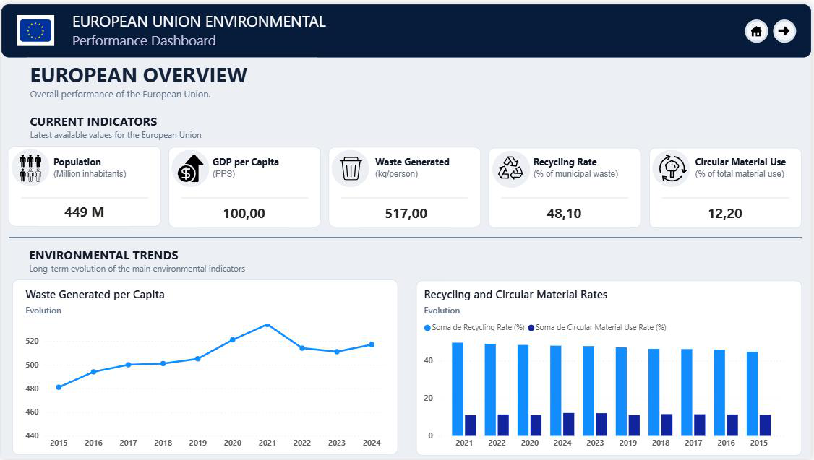
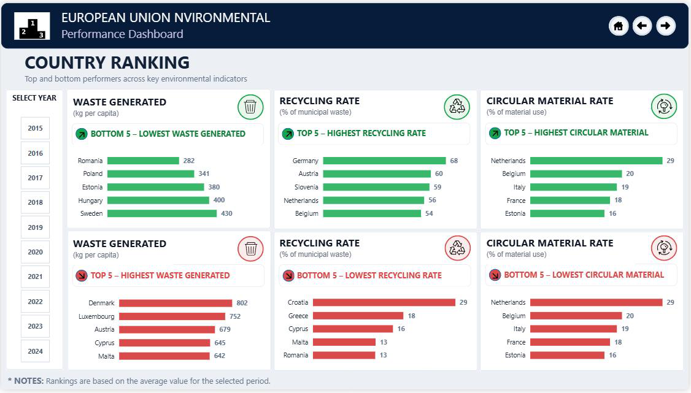
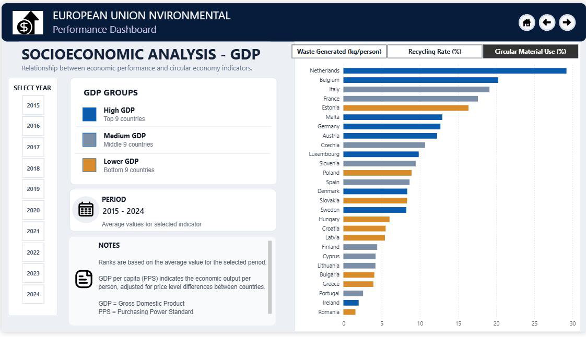
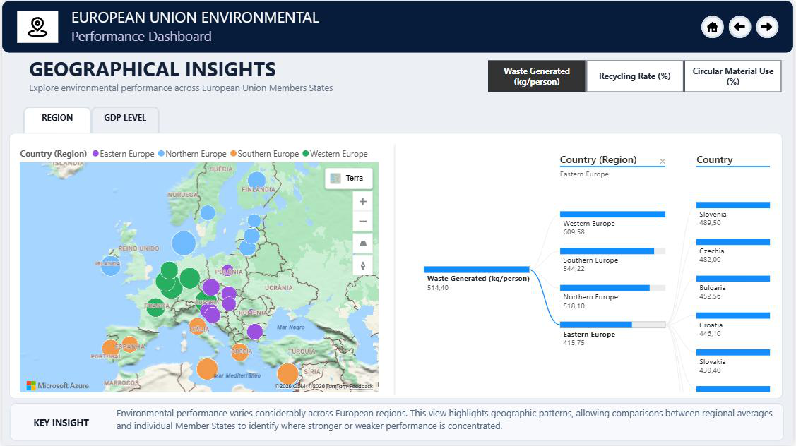
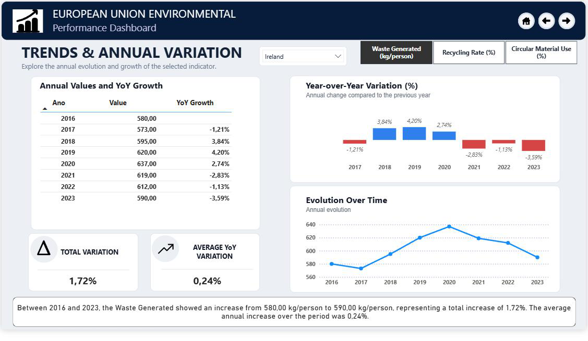
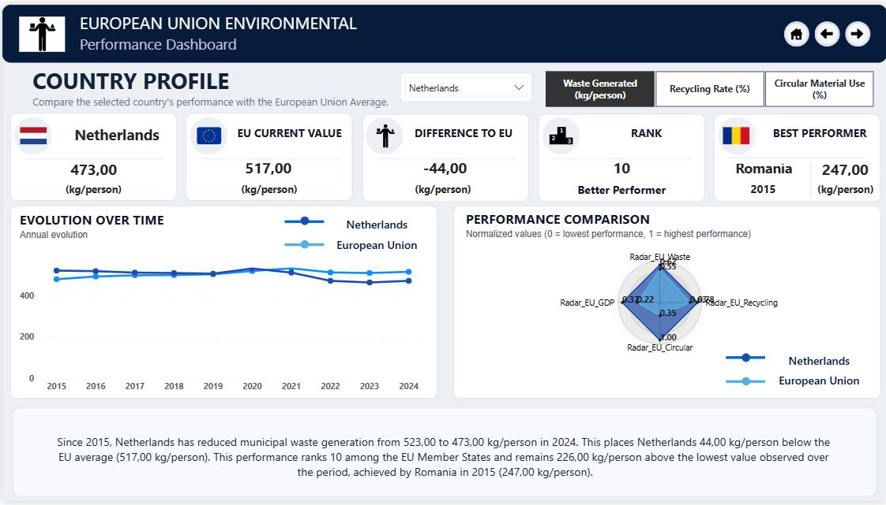
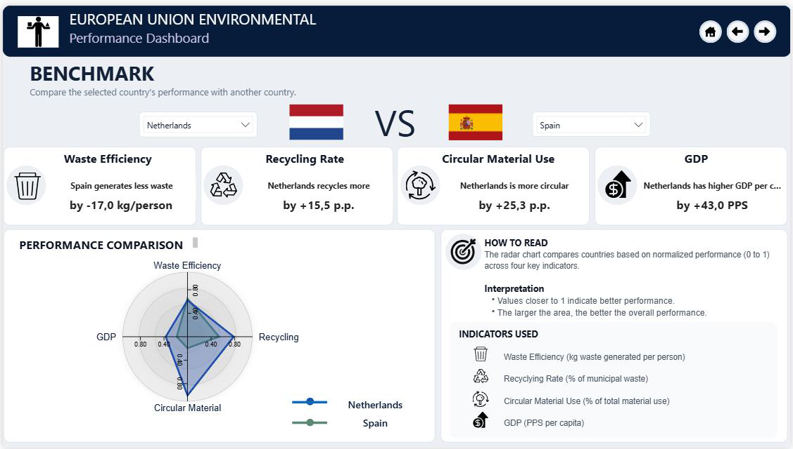
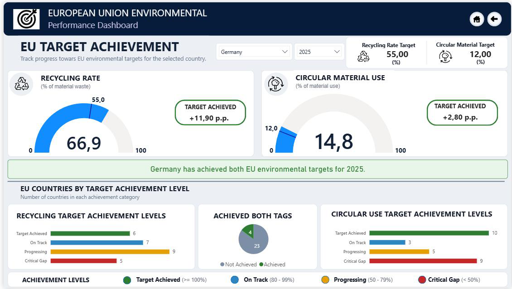

# EU Recycling & Circular Material Performance | Power BI

A Business Intelligence capstone project exploring recycling, circular material use, and related socioeconomic indicators across the **27 European Union member states** over **2015–2024**.

The project combines five Eurostat datasets and uses Power BI, Power Query, data modelling, and DAX to support interactive country comparisons, time-series analysis, rankings, and environmental target tracking.



## Project objectives

- Integrate environmental and socioeconomic data from multiple Eurostat sources.
- Prepare and model the data for consistent analysis across countries and years.
- Explore differences in waste management, recycling performance, and circular material use.
- Present trends, comparisons, and progress towards environmental objectives through interactive reports.

## Data sources

Five Eurostat datasets were used:

1. Municipal waste by waste management operations
2. Recycling rate of municipal waste
3. Circular material use rate
4. Country population
5. GDP per capita in purchasing power standards (PPS)

**Coverage:** EU-27, 2015–2024. Source files and prepared datasets are kept separately to document the data preparation process. Availability may vary by indicator, country, and year.

**Data provider:** [Eurostat](https://ec.europa.eu/eurostat/)

## Dashboard pages

| Page | Focus |
|---|---|
| Overview | High-level environmental performance indicators |
| Rankings | Dynamic country rankings |
| Socioeconomic Analysis | Relationships between economic and environmental indicators |
| Geographical Insights | Geographic distribution of performance |
| Trends | Changes over time |
| Country Profile | Detailed country-level analysis |
| Benchmark | Side-by-side country comparison |
| Achievements | Progress towards environmental targets |

### Dashboard gallery















## Tools and techniques

- **Power BI Desktop** — interactive report development
- **Power Query** — data ingestion, cleaning, and transformation
- **DAX** — analytical measures, rankings, comparisons, and time-based calculations
- **Dimensional data modelling** — structuring relationships across analytical tables
- **Eurostat** — public statistical data

## Repository structure

```text
eu-circular-economy-powerbi/
├── 01_Source_Data/
│   ├── eurostat_original/
│   └── prepared_datasets/
├── 02_PowerBI/
│   └── FinalVersion_EU_RecyclingAndCircularMaterialPerformance.pbix
├── 03_Screenshots/
│   ├── 01_overview.png
│   ├── 02_rankings.png
│   ├── 03_socioeconomic_analysis.png
│   ├── 04_geographical_insights.png
│   ├── 05_trends.png
│   ├── 06_country_profile.png
│   ├── 07_benchmark.png
│   └── 08_achievements.png
├── 04_Report/
│   └── Final_Project_Report.pdf
└── README.md
```

## How to explore the project

1. Review the screenshots for a quick overview of the eight report pages.
2. Read the [project report](04_Report/Final_Project_Report.pdf) for the methodology, data preparation, modelling, and implementation details.
3. Download and open the `.pbix` file in **Power BI Desktop** to explore the interactive report.
4. If refreshing the data, update the local file paths in **Data source settings** to point to the dataset files on your computer.

**Note:** The geographic page uses Azure Maps. Depending on the Power BI environment, online service availability, sign-in, and organizational settings, that visual may not load. The screenshots document the report as originally presented. Other functionality has not been independently revalidated in this repository release.

## Project context

This project was developed as the final assignment for a **Data Analytics and Business Intelligence training programme (2026)**. It demonstrates an end-to-end BI workflow, from collecting and preparing public datasets to modelling data, defining analytical measures, and designing interactive reports.

## Author

**Eder Tolentino**  
[GitHub](https://github.com/EderTolentino) · [LinkedIn](https://www.linkedin.com/in/edertolentino/)

## Data attribution

Statistical datasets: **Eurostat / European Commission**. Refer to Eurostat for the source data, metadata, and applicable reuse terms.
